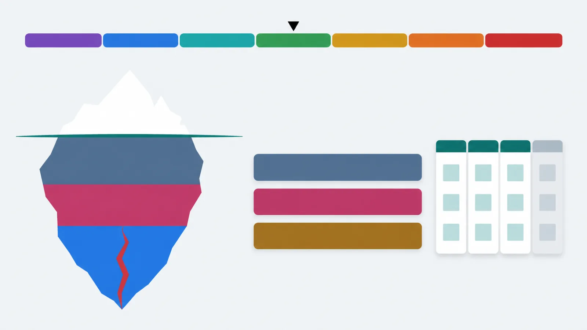

[Русский](README.md) · English

# The neurointegration method at hand: what to do today, what to do when it hits, and why — with the lesson behind it

The `/nif` skill for Claude Code guides you through Katerina Lengold's neurointegration method. It
tells you where you are in the sprint, answers questions on the method, gives one practice for your
NeuroBalance zone and reviews your sprint projects. It needs no course materials: the whole method is
retold in plain words inside the plugin. The retelling is in Russian; the skill answers in your
language.

```
claude plugin marketplace add https://github.com/beCyborg/jadlis-hub.git
claude plugin install jadlis-nif@jadlis
```



In words: seven coloured zones of the scale from burnout to distress, below them the iceberg
"state — thinking — actions" and the sprint band "3 weeks · 3 projects · 30 hours".

This is an unofficial summary. The method was created by Katerina Lengold; the programme is run by
the Neurointegration Institute. The full course with audio, assignments and trainers is theirs. There
are no course texts, slides or audio here — only a retelling in my own words.

## Why

The method answers five familiar problems:

| Problem | What the method offers | Where in the course |
|---|---|---|
| I set a big goal and drop it | Change at most 10% of your time: a 3-week sprint, 3 projects, 30 hours | lessons 1.2, 1.4 |
| Stress piles up | Notice your zone on the scale, lower the peak with breathing, clear the stress with a walk | lessons 2.2–2.8 |
| I know what to do but put it off | Spot the habitual scenario — ignoring, preparing or fighting — and choose the route on purpose | lessons 4.1–5.2 |
| Life is one long race | Alternate Drive, the new and important, with Joy, enjoying what you already have | lessons 1.3, 1.5 |
| I can't see progress | Short reflections and the sprint review make progress visible | lessons 1.7, 5.3 |

The course gives you the method over six weeks. The skill is for when the course is over, when you
never took it, or when it runs right now and you need an answer in the moment: on a Wednesday
evening, before a hard conversation, while planning the next sprint.

## What it looks like

**The method atlas** — one page with every scene and a voice guide. One button, "Слушать гид", and
the voice walks you through the page chapter by chapter (in Russian):
https://claude.ai/artifact/WAsFS3U4X5sK2p6spGE76N

The skill's five modes:

| Mode | Example question | What you get |
|---|---|---|
| Where am I, what's next | "What's on the course today?" | Sprint day, the day's audio from the retelling, the week's lessons, one action |
| A question on the method | "How many hours should a sprint take?" | An answer with the lesson and a "Science" note where research says otherwise |
| Acute state | "I'm shaking before a call" | The zone, one practice step by step, a plan for the rest of the day; alarming symptoms go straight to a doctor |
| Review of your own planning | "Check my week plan against the method" | A table "method — yours — gap — suggestion" |
| Sprint projects | "I want a marathon and English in my sprint" | Per project "ok" or "fix", with one better wording |

Inside the plugin there are 85 retelling files: 36 lessons, 13 practices, 18 sprint days, 11
protocols, 4 glossaries, the programme map, the scale zones and 24 science notes.

## Installing

You need Claude Code. No API keys or third-party subscriptions.

```
claude plugin marketplace add https://github.com/beCyborg/jadlis-hub.git
claude plugin install jadlis-nif@jadlis
claude plugin list
```

The first command adds the marketplace, the second installs the plugin. To remove it:
`claude plugin uninstall jadlis-nif@jadlis`.

**Personal profile — optional.** If you want your own rituals, links to your own notes or your own
emergency number, create a `nif-profile.md` file and set its path — in a session with `/config`,
or with:

```
echo '{"PROFILE_PATH":"~/nif-profile.md"}' | claude plugin configure jadlis-nif@jadlis --values-stdin
```

A template: [docs/nif-profile.example.md](docs/nif-profile.example.md). A profile changes rituals, links and where notes are written. It cannot switch off the safety rules
or the lesson references.

## Using it

Type in Claude Code:

```
/jadlis-nif:nif what's next in the course?
```

Or just ask in your own words: "what's my zone", "which practice now", "check my sprint projects".
The skill asks for your sprint start date once and remembers it. To mark a lesson as done: "done
with lesson 1.4".

The skill labels every claim about the method with its lesson. When the retelling has no answer, it
says so and names the closest lesson. It refuses to quote the course, even when asked.

## Limits and cost

**What it does not do.** No diagnoses and no medication advice. With chest pain, fainting or
thoughts of self-harm it gives no practice and sends you to a doctor or emergency services. The
method does not replace therapy: with lasting panic or apathy the skill suggests a specialist. This
is a retelling, not the course: audio, assignments and trainer feedback stay with the Institute.

**What it costs.** One answer reads one to three retelling files, a few thousand tokens of your
Claude Code quota. Nothing beyond your subscription.

**Tested:** 20 `claude plugin eval` scenarios in an isolated environment without notes or course
files, script tests, and a check for verbatim overlap with the course materials. Tested on my Mac;
not on other machines — if it fails to install, open an issue.

**Terms of use.** No licence: all rights to the retelling are reserved by the author. Reading and
personal use are fine. Commercial use and republishing by agreement. The method and its names belong
to their author. If the rights holder asks me to take the summary down, I will.

**Updating.** Auto-update is off for third-party marketplaces. Get a new version with:

```
claude plugin marketplace update jadlis
claude plugin update jadlis-nif@jadlis
```
