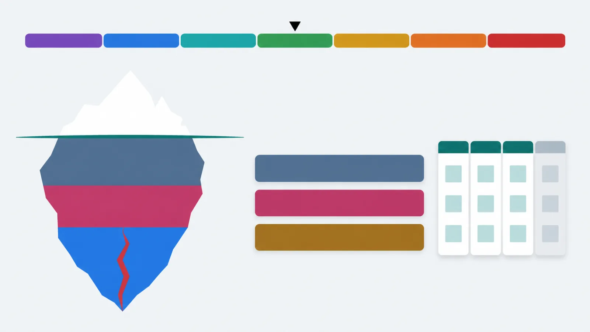

Русский · [English](README.en.md)

# Метод нейроинтеграции под рукой: что делать сегодня, что делать, когда накрыло, и почему — со ссылкой на урок

Скилл `/nif` для Claude Code ведёт по методу нейроинтеграции Катерины Ленгольд. Он подскажет, где
ты в спринте, ответит на вопрос по методу, даст одну практику по зоне шкалы НейроБаланса и
разберёт твои проекты на спринт. Материалы курса ему не нужны: весь метод пересказан своими
словами внутри плагина.

```
claude plugin marketplace add https://github.com/beCyborg/jadlis-hub.git
claude plugin install jadlis-nif@jadlis
```



Текстом: семь цветных зон шкалы от выгорания до дистресса, под ними айсберг «состояние — мышление
— действия» и полоса спринта «3 недели · 3 проекта · 30 часов».

Это неофициальный конспект. Метод создала Катерина Ленгольд, программу ведёт Институт
Нейроинтеграции. Полный курс с аудио, заданиями и тренерами — у них. Здесь нет текстов, слайдов
и аудио курса: только пересказ своими словами.

## Зачем

Метод отвечает на пять знакомых проблем:

| Проблема | Что предлагает метод | Где в курсе |
|---|---|---|
| Ставлю большую цель и бросаю | Меняй не больше 10% времени: спринт на 3 недели, 3 проекта, 30 часов | уроки 1.2, 1.4 |
| Стресс копится | Замечай зону на шкале, снижай пик дыханием, выводи стресс прогулкой | уроки 2.2–2.8 |
| Знаю, что делать, но откладываю | Заметь привычный сценарий — игнорирование, подготовку или борьбу — и выбери маршрут сознательно | уроки 4.1–5.2 |
| Живу одной гонкой | Чередуй Драйв, то есть новое и важное, с Кайфом — удовольствием от того, что уже есть | уроки 1.3, 1.5 |
| Не вижу прогресса | Короткие рефлексии и итоги спринта делают прогресс видимым | уроки 1.7, 5.3 |

Курс даёт метод на шесть недель. Скилл нужен, когда курс закончился, ты его не проходил или он
идёт прямо сейчас, а ответ нужен в моменте: в среду вечером, перед трудным разговором, при
планировании следующего спринта.

## Как выглядит

**Атлас метода** — одна страница со всеми сценами и голосовым гидом. Одна кнопка «Слушать гид»,
и голос ведёт по странице главу за главой: https://claude.ai/artifact/WAsFS3U4X5sK2p6spGE76N

Пять режимов скилла:

| Режим | Пример вопроса | Что получишь |
|---|---|---|
| Где я и что дальше | «Что сегодня по курсу?» | День спринта, аудио дня из пересказа, уроки недели, одно действие |
| Вопрос по методу | «Сколько часов закладывать на спринт?» | Ответ со ссылкой на урок и пометкой «Наука», если наука говорит иначе |
| Острое состояние | «Меня трясёт перед звонком» | Зона, одна практика по шагам, план на остаток дня; тревожные симптомы — сразу к врачу |
| Разбор своего планирования | «Проверь мой план недели по методу» | Таблица «метод — у тебя — расхождение — предложение» |
| Проекты спринта | «Хочу на спринт марафон и английский» | По каждому проекту «ок» или «поправить», с одной формулировкой лучше |

Внутри плагина лежат 85 файлов пересказа: 36 уроков, 13 практик, 18 дней спринта, 11
протоколов, 4 словаря, карта программы, зоны шкалы и 24 научные пометки.

## Как поставить

Нужен Claude Code. Ключи API и подписки сторонних сервисов не нужны.

```
claude plugin marketplace add https://github.com/beCyborg/jadlis-hub.git
claude plugin install jadlis-nif@jadlis
claude plugin list
```

Первая команда добавляет маркетплейс, вторая ставит плагин. Удалить:
`claude plugin uninstall jadlis-nif@jadlis`.

**Личный профиль — по желанию.** Если хочешь свои ритуалы, ссылки на свои заметки или свой номер
экстренной службы, создай файл `nif-profile.md` и укажи путь к нему — в сессии через `/config`
или командой:

```
echo '{"PROFILE_PATH":"~/nif-profile.md"}' | claude plugin configure jadlis-nif@jadlis --values-stdin
```

Образец — [docs/nif-profile.example.md](docs/nif-profile.example.md). Профиль меняет ритуалы, ссылки и место записи. Правила безопасности и ссылки на уроки он не
отключает.

## Как пользоваться

Набери в Claude Code:

```
/jadlis-nif:nif что дальше по курсу?
```

Или просто спроси своими словами: «какая у меня зона», «какую практику сделать», «проверь проекты
на спринт». Скилл спросит дату старта спринта один раз и запомнит её. Отметить пройденный урок:
«прошёл урок 1.4».

Каждое утверждение о методе скилл подписывает уроком. Если в пересказе ответа нет, он так и
скажет и назовёт ближайший урок. Цитировать курс он отказывается, даже если попросить.

## Границы и стоимость

**Чего не делает.** Не ставит диагнозов и не советует лекарств. При боли в груди, обмороке или
мыслях о самоповреждении он не даёт практик, а направляет к врачу или в экстренную службу. Метод не
заменяет психотерапию: при долгой панике или апатии скилл предложит специалиста. Это пересказ, а
не курс: аудио, задания и обратная связь тренеров остаются у Института.

**Что тратит.** Один ответ читает от одного до трёх файлов пересказа, это несколько тысяч токенов
из твоей квоты Claude Code. Денег сверх подписки не требует.

**Проверено:** 20 сценариев `claude plugin eval` в изолированной среде без заметок и курса,
тесты скрипта, проверка на дословные совпадения с материалами курса. Проверял на своём Mac; на
других машинах не проверял — если не встало, напиши в issue.

**Условия использования.** Лицензии нет: все права на пересказ сохранены за автором. Читать и
пользоваться лично можно. Коммерческое использование и переиздание — по договорённости. Метод и
его названия принадлежат их автору. Если правообладатель попросит убрать конспект, я его уберу.

**Обновление.** У стороннего маркетплейса авто-обновление выключено. Новую версию получишь так:

```
claude plugin marketplace update jadlis
claude plugin update jadlis-nif@jadlis
```
